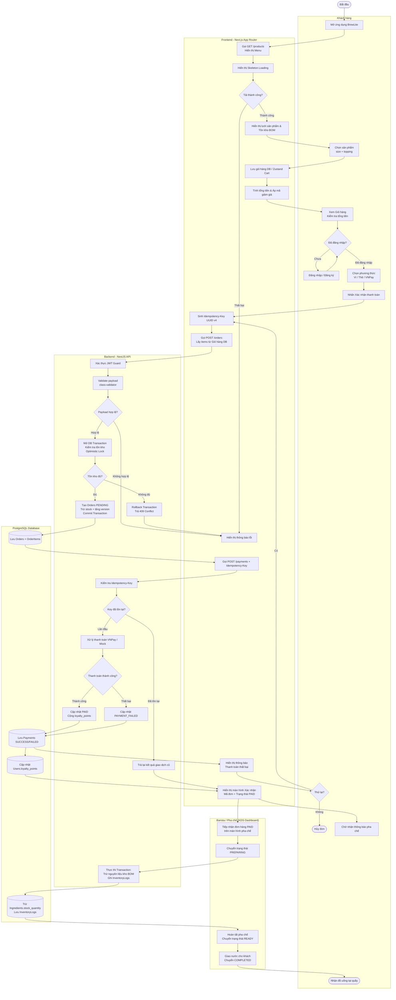

# Activity Diagram — Luồng Đặt và Thanh toán (End-to-End)

> **Use-Case:** UC-07 — Checkout & Order Fulfillment  
> **Công cụ:** Mermaid  
> **Cập nhật:** 2026-11-14

## Sơ đồ

## Ghi chú các Phân vùng (Swimlanes)

| Swimlane | Thành phần | Trách nhiệm chính |
|---|---|---|
| `USER` | Khách hàng | Duyệt thực đơn, chọn Size/Topping, thêm giỏ, thanh toán và nhận đồ uống tại quầy. |
| `FRONTEND` | Next.js App Router | Giao diện PWA, đồng bộ giỏ hàng với Database, sinh Idempotency-Key và hiển thị tiến độ. |
| `BACKEND` | NestJS API | Bảo vệ JWT Guard, kiểm soát State Machine, khóa Optimistic Lock và trừ kho BOM trong Transaction. |
| `BARISTA` | Màn hình KDS | Tiếp nhận đơn `PAID`, chuyển `PREPARING` để pha chế và `READY` khi hoàn tất. |
| `DB` | PostgreSQL | Lưu trữ bền vững dữ liệu Đơn hàng, Thanh toán, Điểm thưởng và Nhật ký kho (`InventoryLogs`). |

## Các nhánh Ngoại lệ được thể hiện

1. **API lỗi khi tải menu** $\rightarrow$ Hiển thị thông báo lỗi, không crash app.
2. **Chưa đăng nhập** $\rightarrow$ Chuyển hướng đăng nhập, tự động đồng bộ giỏ hàng DB.
3. **Payload không hợp lệ** $\rightarrow$ Trả 400 Bad Request, hiển thị thông báo validation chi tiết.
4. **Hết hàng hoặc xung đột phiên bản (Optimistic Lock thất bại)** $\rightarrow$ Rollback transaction, trả 409 Conflict.
5. **Thanh toán thất bại** $\rightarrow$ Chuyển đơn sang `PAYMENT_FAILED`, giữ nguyên giỏ hàng cho phép khách hàng Retry với phương thức khác.
6. **Retry trùng lặp (same Idempotency-Key)** $\rightarrow$ Trả kết quả giao dịch cũ, ngăn chặn trừ tiền 2 lần.
