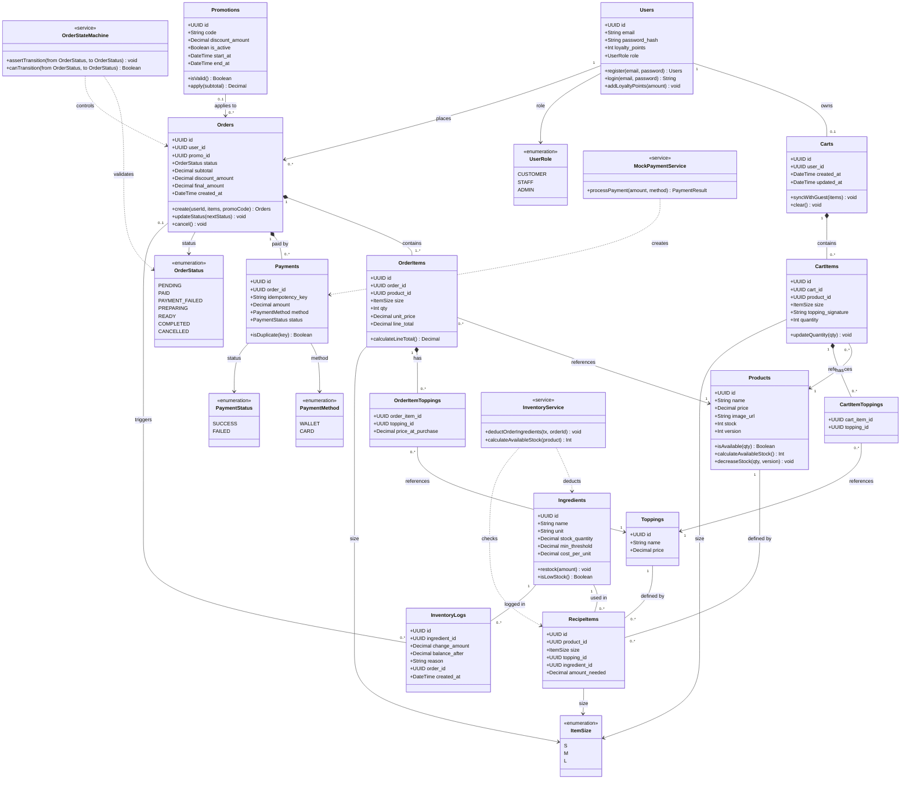

# Class Diagram — Domain Model BrewLite

> **Mức độ:** Domain / Business Layer  
> **Công cụ:** Mermaid  
> **Căn cứ:** `apps/api/prisma/schema.prisma` (Khớp 100% CSDL 12 bảng)  
> **Cập nhật:** 2026-11-14

## Sơ đồ

## Mô tả Chi tiết các Lớp

### 1. Phân hệ Người dùng & Giỏ hàng (User & Cart Domain)

| Lớp | Vai trò | Ghi chú quan trọng |
|---|---|---|
| `Users` | Tài khoản người dùng | `password_hash` băm bcrypt; `loyalty_points` tích lũy tự động; `role` phân quyền (CUSTOMER, STAFF, ADMIN). |
| `Carts` | Giỏ hàng lưu trữ Database | Mỗi người dùng có tối đa 1 giỏ hàng active gắn với `user_id`. Tự động đồng bộ từ Guest Cart khi đăng nhập. |
| `CartItems` | Dòng sản phẩm trong giỏ hàng | Lưu `product_id`, `size`, `quantity` và `topping_signature` để nhóm sản phẩm cùng tùy chọn. |
| `CartItemToppings` | Topping được chọn trong giỏ hàng | Bảng liên kết nhiều-nhiều giữa `CartItems` và `Toppings`. |

### 2. Phân hệ Thực đơn & Định mức Kho (Product & BOM Inventory Domain)

| Lớp | Vai trò | Ghi chú quan trọng |
|---|---|---|
| `Products` | Sản phẩm trong menu | Quản lý `price`, `stock` và `version` (Optimistic Locking); tính toán số ly pha chế tối đa dựa trên định mức BOM. |
| `Toppings` | Topping thêm vào đồ uống | Có giá độc lập và định mức công thức pha chế riêng. |
| `Ingredients` | Nguyên liệu thô trong kho | Theo dõi tồn kho (`stock_quantity`), đơn vị đo lường (`unit`), ngưỡng cảnh báo (`min_threshold`). |
| `RecipeItems` | Định mức công thức (BOM) | Quy định lượng nguyên liệu (`amount_needed`) cấu thành nên từng món nước theo Size (S/M/L) hoặc Topping. |
| `InventoryLogs` | Nhật ký biến động kho | Lưu vết mọi lần trừ kho (khi pha chế đơn hàng `PREPARING`) hoặc nhập thêm nguyên liệu (`RESTOCK`). |

### 3. Phân hệ Đơn hàng & Thanh toán (Order & Payment Domain)

| Lớp | Vai trò | Ghi chú quan trọng |
|---|---|---|
| `Orders` | Đơn hàng của khách hàng | Trạng thái chuyển đổi qua Finite State Machine (`PENDING` $\to$ `PAID` $\to$ `PREPARING` $\to$ `READY` $\to$ `COMPLETED`). |
| `OrderItems` | Dòng món trong đơn hàng | Lưu `unit_price` và `line_total` snapshot tại thời điểm đặt đơn. |
| `OrderItemToppings` | Topping chọn trong dòng món | Lưu `price_at_purchase` snapshot để bảo đảm tính toàn vẹn tài chính. |
| `Payments` | Giao dịch thanh toán | Chứa `idempotency_key` duy nhất để ngăn ngừa double-spending (trừ tiền 2 lần). |
| `Promotions` | Mã ưu đãi giảm giá | Xác thực điều kiện kích hoạt, thời hạn hiệu lực và khấu trừ giảm giá vào đơn hàng. |

### 4. Lớp Dịch vụ Miền (Domain Services)

| Lớp | Vai trò | Phương thức chính |
|---|---|---|
| `OrderStateMachine` | Kiểm soát vòng đời đơn hàng | `assertTransition(from, to)` — ngăn chặn chuyển trạng thái phi logic. |
| `InventoryService` | Xử lý kho theo công thức BOM | `deductOrderIngredients(tx, orderId)` — trừ kho nguyên liệu tự động trong Database Transaction. |
| `MockPaymentService` | Xử lý thanh toán Idempotent | `processPayment(amount, method)` — hỗ trợ thanh toán ví/thẻ và tích hợp VNPay Sandbox. |
